 

### ✧･ﾟ: ✦ About Me ✦ :･ﾟ✧

| | |
|---|---|
| 🌌 **Computational Astronomy** | Using computation, algorithms, and machine learning to investigate astronomical data and scientific phenomena |
| 🔭 **Telescope Imaging** | Astronomical image processing, telescope observations, image enhancement, source detection, extracting information from celestial images |
| ⭐ **Observational Astronomy & Astrophysics** | Exoplanets, variable stars, stellar phenomena, transient events, unexplored astronomical objects |
| ☄️ **Citizen Science** | Astronomical search campaigns through NASA's International Astronomical Search Collaboration (IASC) |
| 🧠 **Artificial Intelligence** | Deep learning, computer vision, multimodal learning, Generative AI, Agentic AI |
| 🤖 **Intelligent Systems** | LLM-powered applications, multi-agent architectures, AI-assisted scientific research |
| ⚙️ **Software Engineering** | Backend engineering, distributed systems, scalable applications, data-intensive computing |

### ✧･ﾟ: ✦ Areas of Interest ✦ :･ﾟ✧

<b>🌠 Tap to expand or collapse</b>

 

`Astronomical Data Analysis` `Time-Series Analysis` `Scientific Computing` `Computational Astrophysics` `Telescope Image Processing` `Image Enhancement` `Astronomical Source Detection` `Observational Astronomy` `Stellar Variability` `Exoplanets` `Transient Phenomena` `Deep Learning` `Anomaly Detection` `Computer Vision` `Automated Candidate Classification` `Generative AI` `LLMs` `Agentic AI` `Multi-Agent Systems` `Backend Development` `Distributed Systems` `Database Systems` `API Design` `Earth Observation` `Satellite Imagery` `Geospatial AI`

### ✧･ﾟ: ✦ Achievements & Recognition ✦ :･ﾟ✧

| | |
|---|---|
| ☄️ **NASA IASC Citizen Scientist** (2022 to Present) | Contributed to astronomical search campaigns using Astrometrica; credited with one preliminary asteroid discovery |
| 🥈 **International Astronomy and Astrophysics Competition 2024** | Silver Honour, Top 10% worldwide |
| 🌍 **Space Generation Advisory Council (SGAC)** | Selected international delegate for Space Generation Korea 2026 and the 12th Asia-Pacific Space Generation Workshop 2026. SGAC holds permanent observer status at the UN Committee on the Peaceful Uses of Outer Space (UN COPUOS) |
| 🏆 **IIT (BHU) AI/ML Hackathon** | Secured Rank 4 |
| 🎓 **Amazon ML Summer School 2025** | Selected Scholar |
| 🌡️ **Climate Science Olympiad 2024** | Global Semifinalist among 55,000+ participants. The Olympiad is supported by the UN Framework Convention on Climate Change (UNFCCC) and connected to the UN Climate Summit |
| 💻 **Competitive Programming & Hackathons** | Advanced to Round 2 in Google Big Code 2026 and the Economic Times GenAI Hackathon 2026; participated in Flipkart GRiD and Meesho Scripted by Her |
| 🌱 **Open Source Contributions** | Hacktoberfest, GirlScript Summer of Code (GSSoC), KWoC, and SWOC |

### ✧･ﾟ: ✦ Research Experience ✦ :･ﾟ✧

**AI/ML Research Intern | National Institute of Technology Delhi**

- Multimodal deep learning for liver fibrosis and cirrhosis classification using ultrasound and MRI
- Attention-enhanced U-Net segmentation; ResNet-50, ConvNeXt, and Swin Transformer architectures
- Uncertainty-aware prediction, deep learning ensembles, and multimodal feature fusion

| 🩻 Ultrasound Fibrosis Staging | 🧲 MRI Cirrhosis Classification |
|:---:|:---:|
| **96.9%** accuracy | **94.5%** accuracy |

### ✧･ﾟ: ✦ Beyond the Code ✦ :･ﾟ✧

- Exploring how computational methods can help answer questions about the universe
- Following developments in astronomy, astrophysics, space missions, and scientific instrumentation
- Interdisciplinary research at the intersection of computer science, astronomy, and artificial intelligence
- Contributing to open-source communities and learning through technical competitions

# Tech Stack:
                       

### ✧･ﾟ: ✦ GitHub Stats ✦ :･ﾟ✧

 

  

 

---

